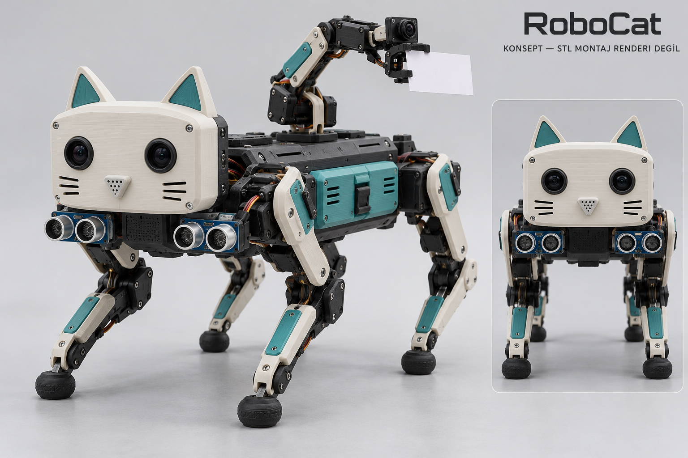
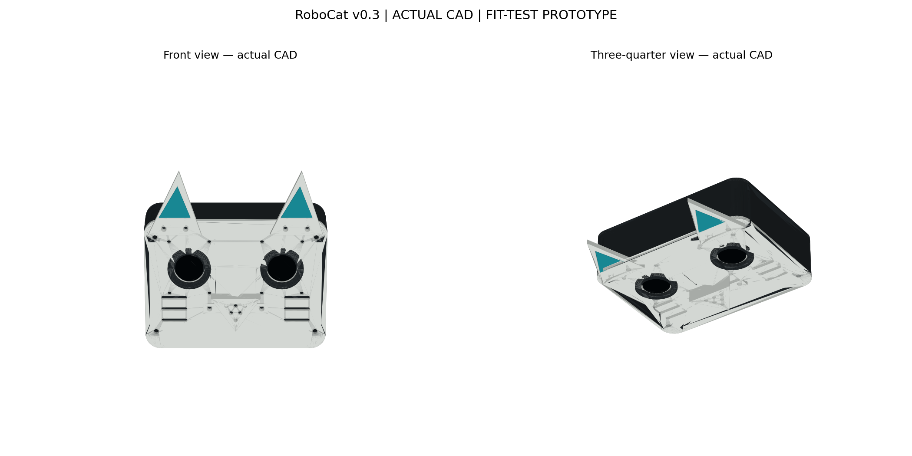
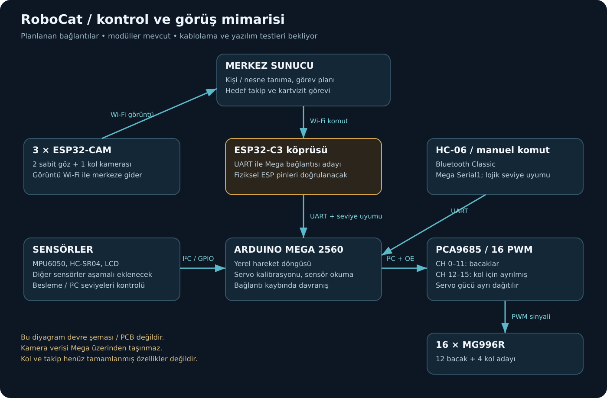
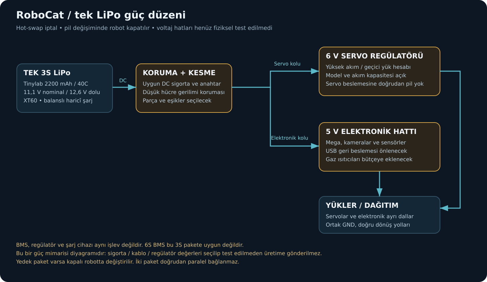

# RoboCat

> **Metalik PETG hazırlığı:** [v0.5 aşama talimatı](custom/petg-stage-v0.5/README.md) · [6 tek-parça deneme işi](custom/petg-stage-v0.5/metallic_queue.json). Düzeltilmiş CAT06B tek katıdır. Durum: PETG ve açık kullanıcı baskı komutu bekleniyor; otomatik başlatma yok. Sıcaklıklar ve gerçek yazıcı profili doğrulanmadan G-code üretilmez/gönderilmez. v0.4 genel uyum listesi ayrı korunur.

**Dört ayaklı robot kedi · yerel hareket kontrolü · merkezde görüntü işleme**

[Başlangıç](docs/README.md) · [Kılavuz](docs/KILAVUZ.md) · [Kurulum](docs/KURULUM.md) · [Bağlantı](docs/BAGLANTI.md) · [Görsel galeri](docs/GALLERY.md) · [Baskı merkezi](docs/PRINTING.md) · [Donanım](hardware/README.md) · [Yol haritası](docs/ROADMAP.md)

*Bu hedef konsepttir, bitmiş robot fotoğrafı veya STL montaj renderı değildir. Kol ve bacak kaplamalarının tamamı modellenmiş değildir.*

## Bugünkü durum

| Bölüm | Durum |
|---|---|
| Envanter | 16 MG996R, Mega R3, PCA9685, 3 kamera, 5 ultrasonik, 2 IMU sipariş listesinden kaydedildi |
| Kafa | v0.3 CAD/STL/STEP var; gerçek kamera ve gövde uyumu bekliyor |
| Baskı | v0.4 içinde 8 ayrı uyum işi; otomatik başlatma kapalı öneriliyor |
| Batarya | 2× 3S LiPo 2200 mAh / 40C alındı (biri yedek, robot kapalıyken değişir); hot-swap iptal |
| LiPo tepsisi | Yalnız boş/dummy deneme; gövde bağlantısı ve elektrik tamamlanmadı |
| Yürüyüş / kol | Önce modüllerle masaüstü kalibrasyon; çalışan entegrasyon henüz doğrulanmadı |
| PCB | Mimari ve pin planı; üretime hazır şematik/Gerber yok |
| Tedarik | 2026-10-26: 2× 3S LiPo, TCA9548A, XL4016, PWM hız kontrolü, voltmetre, sis yapıcı, PIR, 6 V servo regülatörü, XT60/kablo ve 12 servo uzatma alındı; 625 rulman temin edildi. Alüminyum horn ertelendi (plastik ile başlanacak). Testler bekliyor |
| Mega / USB | CH340 portu görünüyor ama avrdude imza okuma 12/12 başarısız; fiziksel teyit bekliyor |
| Fotoğraf kaydı | 20 gerçek kare: baskı, kart, sensör, süpürge parçaları; HW-373 geliştirme kartı değil |

## Önce ne basılacak?

**[v0.4 baskı talimatı](custom/print-fit-v0.4/README.md)** ve **[iş manifesti](custom/print-fit-v0.4/print_manifest.json)** güncel referanstır.

1. Lens kuponu ve tek kamera taşıyıcısıyla ölçü denemesi.
2. Tek kulak ve iç parçasıyla tolerans denemesi.
3. Yüz/kasa/arka kapakta kuru montaj; basılan CAT01/CAT02 yeniden otomatik sıraya eklenmez.
4. Yeni LiPo tepsisinde boş/dummy ölçü denemesi.

**CAT10 kızak, eski 18650 kartuşları/kızağı, BAT01 eski pil kapağı ve nihai montajı doğrulanmamış omuz braketi basılmayacak.** Manifesti okumayan otomasyon bu listeyle kendiliğinden engellenmez; bütün STL klasörünü otomatik basmayın. Destekleri doğrulanmış G-code/3MF bu depoda yoktur.

## Gerçek kafa modeli

[STL/STEP](custom/robocat-v0.3/stl) · [Kafa montajı STEP](custom/robocat-v0.3/head_assembly.step) · [Montaj kontrol kapsamı](custom/robocat-v0.3/assembly_check.json).

Beyaz yüz/kulak/burun, koyu kasa/göz çerçeveleri ve turkuaz kulak içleri ayrı basılır. CAD kontrolü gerçek vidalar, lens/kart/ribbon veya robot gövdesini kapsamaz. Burun hava girişidir; gaz ölçüm sistemi henüz entegre değildir.

## Sistem mimarisi

Mega yerel hareket döngüsünü yürütür; PCA9685 16 PWM kanalı üretir. 12 bacak servosu ve dört kol adayı vardır. İki kafa kamerası ve bir kol kamerası görüntüyü merkeze Wi-Fi ile gönderir. Tanıma, yaklaşık 1 m takip ve kartvizit sunma hedef özelliklerdir; uygulanmış/test edilmiş kabul edilmez.

## Tek LiPo / güç

Hot-swap iptal: pil robot kapalıyken değiştirilir, ikinci paket yalnız yedektir. 3S paket servolara doğrudan bağlanmaz. 6 V servo ve ayrı 5 V elektronik regülasyonu, sigorta ve düşük hücre gerilimi koruması gerekiyor; kesin güç bileşenleri seçilmedi. Ayrıntı: [güç ve masaüstü test planı](hardware/PCB_PLAN_REV_A.md).

## Dizinler ve kaynaklar

| Dizin | İçerik |
|---|---|
| [docs](docs/README.md) | Güncel görseller, diyagramlar ve durum |
| [hardware](hardware/README.md) | Envanter, pin önerileri ve test planı |
| [custom](custom/README.md) | Yeni ve tarihsel mekanik prototipler |
| [Nova-SM3](Nova-SM3) | Orijinal gövde/bacak/elektronik kaynakları |
| [Nova-SM2](Nova-SM2) | Orijinal önceki sürüm kaynakları |

[Kapsamlı kaynak haritası](docs/SOURCES.md). Upstream diğer projeler ve kumanda STL'leri RoboCat'in otomatik baskı listesi değildir. Nova-SM3'ün kaynak Gerber'i Mega/MG996R konfigürasyonumuz için onaylı değildir.

## Yeniden üretme

- Kafa: `python custom/robocat-v0.3/generate.py` (CadQuery, numpy, matplotlib).
- Boş LiPo tepsisi: `python custom/print-fit-v0.4/generate_lipo_tray.py` (CadQuery).
- Kontrollü paket: `python custom/print-fit-v0.4/build_pack.py` (standart Python).
- Diyagramlar: `python docs/diagrams/render_diagrams.py` (standart Python).

Eski v0.3 toplu paket ihracı kullanımdan kaldırıldı. Dosya içeriği kontrolleri başarılı baskı veya mekanik test yerine geçmez.

## Atıf / lisans

Bu depo [Chris Locke / cguweb-com Arduino-Projects](https://github.com/cguweb-com/Arduino-Projects) projesinden forklanmıştır. Orijinal kaynaklar, yazar bilgileri ve [MIT lisansı](LICENSE) korunur. Dışarıdan eklenen mekanik tasarımların ayrı lisansları geçerlidir; [kaynak notlarını](docs/SOURCES.md) okuyun.

