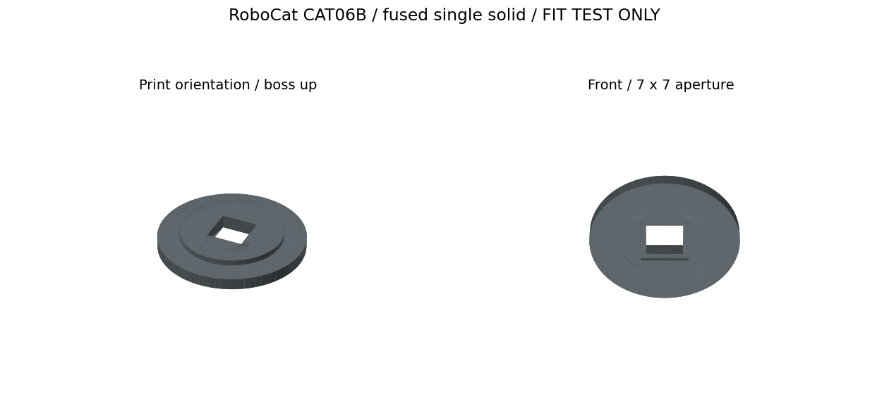

> **GÜNCELLEME 2026-10-25:** Bu sayfa v0.3 parça arşividir. Güncel baskı kararı [v0.4](../print-fit-v0.4/README.md) içindedir. **CAT10 ve BAT01 basılmayacak; eski 18650 kutuları kullanılmayacak.** Basılan yüz/kasa tekrar otomatik sıraya eklenmez.

# RoboCat v0.3 — beğenilen konsepte uygun mekanik taslak

Yeni parçalar orijinal Nova-SM3 gövde/bacak STL'lerini değiştirmez. Konsept görselindeki beyaz/koyu/turkuaz görünüm için kafa renk parçalarına ayrıldı. Bu bir üretim onayı veya görseldeki bütün robotun birebir CAD rekonstrüksiyonu değildir.

## Dosyalar ve baskı adetleri
| Dosya | Adet | Renk / görev |
|---|---:|---|
| TEST01_lens_coupon_x1 | 1 | İlk lens denemesi: soldan sağa 18, 20, 22 mm açıklık |
| CAT01_white_face_x1 | 1 | Beyaz, yuvarlatılmış yüz; göz merkezleri 60 mm aralıklı |
| CAT02_dark_head_shell_x1 | 1 | Koyu renkli arka kafa kasası; ön plaka ayrı |
| CAT03_dark_rear_lid_x1 | 1 | Koyu renkli sökülebilir havalandırmalı arka kapak |
| CAT04_white_ear_x2 | 2 | Beyaz üçgen kulak; M3 geçiş delikleri |
| CAT05_teal_ear_insert_x2 | 2 | Turkuaz kulak içi; yapıştırmadan önce kuru uyum testi |
| CAT06_dark_eye_bezel_x2 | 2 | Siyah, 20 mm iç / 28 mm dış çap göz çerçevesi |
| CAT07_white_vented_nose_x1 | 1 | Beyaz, çıkarılabilir üçgen burun ve hava girişleri |
| CAT08_camera_carrier_x2 | 2 | PCB için kablo bağlamalı taşıyıcı; ölçü doğrulaması gerekli |
| CAT09_camera_spacer_x8 | 8 | 4 mm kamera mesafe parçası |
| CAT10_strap_saddle_x1 | 1 | Kayışlı geçici montaj kızağı; birebir gövde adaptörü değil |
| BAT01_teal_cartridge_lid_x2 | 2 | Önceki üç hücreli kartuşa uyan, kapalı dekoratif girintili turkuaz kapak |

STL: baskı. STEP: parça düzenleme. head_assembly.step: yalnız kafa ve temsili lenslerin birleşimi. cad_head_v0.3.png: gerçek geometrinin görünümü. generate.py: parametrik kaynak (CadQuery, numpy, matplotlib). validation.json ve assembly_check.json: CAD kontrolleri. STL ölçeği mm.

## Montaj / baskı sırası
1. TEST01 ve tek kamera taşıyıcısını basın, gerçek lens/kart/ribbon konumunu ölçün. 20 mm açıklık sensör/lens çapının doğrulanmış ölçüsü değildir.
2. Tek kulak ve iç parçasında toleransı deneyin. Yüz/kapak/kasa ayrı basılır. Burun boş tarafı yukarı basılabilir; delikli ön kapak için dilimleyicide köprüleme kontrol edilir.
3. Başlangıç önerisi PETG, 0,2 mm katman, 4 duvar, %20–30 dolgu. Parçayı geniş düz yüzüne yatırın; ince iç parçalar ve ringlerde ilk katmanı kontrol edin. Kasa, ayak/kayış/sensör parçaları için destek ve baskı yönünü dilimleyicide değerlendirin.
4. Kasa-yüz ve kasa-arka kapak M3 bağlantıları aynı kolonları iki uçtan kullanır. Pilotlar 2,6 mm, geçişler 3,4 mm. Vida boyları henüz sabitlenmedi; karşı vida ile çakıştırmayın. Kamera taşıyıcıları 4 mm mesafe parçalarıyla yüzün arkasına bağlanır; gerçek kart/lens derinliğiyle mesafe revize edilebilir.
5. Kulakların ön yüzündeki ceplere renkli iç parçalar yerleşir. Göz halkaları lens değil dekoratif halkalardır; modülün görüşünü engellemeyecek şekilde tutulmalıdır. Görseldeki yuvarlak siyah lensler temsili, baskı dosyası değildir.
6. Kafa tüm elektronik/kablolarla tartılacak. validation.json içindeki tam dolu malzeme hesabı dilimleyici sonucu değildir. Ön tarafta ek yükün yürüme ve kol dengesi üzerindeki etkisi test edilmeden robot yürütülmez.

## Konsept ile gerçek durum
- TAMAMLANAN: beyaz yüz/kulak/burun, koyu kasa/kapak/göz halkaları, turkuaz kulak içleri, kamera taşıyıcıları, kartuş kapağı ve parametrik geometri.
- PROTOTİP: lens ve PCB uyumu, kayışlı gövde montajı, yüz vida boyları, lens halka tutuşu. Gövdeye rijit bağlantı ve fiziksel baskı testi yok.
- DEĞİŞMEYEN: orijinal Nova-SM3 bacak/gövde STL'leri. Konseptteki şık bacak kaplamaları yeniden üretilmedi.
- SONRA: görseldeki kartvizit kolu, bilek kamerası bağlantısı, elektronik hot-swap, yüksek akım kontakları, sensorlu omuzların son gövde adaptörü.

## Batarya ve burun
BAT01 eski mekanik kartuş kapağının alternatifidir, iki kapağı birden basmayın. Kapaktaki girintiler dekoratiftir; hücre bölmesine açık havalandırma deliği değildir. Kartuş gövde/kızak önceki uyum prototipleridir; kontak, BMS ve elektrik izolasyonu tamamlanmadı. Canlı batarya montajı yapılmayacak.

Burun yalnız hava girişidir; koku sensörü, gaz seçiciliği, pompa/fan ve kalibrasyon yoktur. Sensör seçilince iç yuva tasarlanacak. Isıtıcılı gaz sensörünü plastik buruna doğrudan yerleştirmeyin.

## Doğrulama kapsamı
Tüm yeni baskı parçaları geçerli tek CAD katısı olarak kontrol edildi. Kafa montajında basılı parçalar ve temsili lensler arasında 0,1 mm³ üzerindeki hacim kesişimleri assembly_check.json içine yazılır. Bu kontrol vida, elektronik, optik hizalama, kablo, gerçek gövde veya dayanım testi değildir. Kalan kesişim varsa montaj hatası olarak ele alınmalı, basmadan düzeltilmeli.

Kaynak: Chris Locke / cguweb-com Arduino-Projects, Nova-SM3; telif ve lisanslar korunur. Yeni parçalar bağımsız CadQuery tasarımı, repo MIT lisansı altında. Beğenilen AI konsepti docs/images/robocat-concept-v0.3.png içinde; imalat modeli yerine kullanılmaz.

## Varyant: CAT06B goz cercevesi (7x7 kare, yapistirmali)

`stl/CAT06B_eye_bezel_7x7_boss_x2.stl` — CAT06 yerine kullanilabilecek, **vidasiz/yapistirmali** goz cercevesi.

| Olcu | Deger |
|---|---|
| Dis cap | 27,98 mm (CAT06 ile ayni ayak izi) |
| On cerceve | 9 x 9 mm, 1 mm derinlik |
| Gecis deligi | 7 x 7 mm kare |
| Arka merkezleme bilezigi | 19,6 mm cap x 1,5 mm (yuzdeki 20 mm delige oturur) |
| Toplam yukseklik | 4,5 mm |
| Vida deligi | yok |

Yapistirma onerisi: notr kürlenen silikon (sokulebilir) veya CA. Montaj oncesi yuzey IPA ile temizlenmeli, silikon ince surulmeli.

Durum: yalniz CAD. Baski toleransi, yapisma dayanimi, sensor/lens derinligi ve isi testi yapilmadi. CAT06'nin yerine gecmesi icin gercek sensör/modul olcusu ve arka bosluk dogrulanmali. v0.4 manifestinde CAT06 işi bulunmaz. Güncel metalik deneme işi v0.5 M02 içindedir; önce yalnız bir adet basılır.

## 2026-10-26 CAT06B mesh düzeltmesi / metalik aşama
Önceki varyanttaki üç örtüşen kapalı mesh kabuğu Boolean union ile tek geçerli katı hâline getirildi. STL büyük ön yüz tabanda, bilezik yukarı ve minZ=0 olacak şekilde yeniden çıkarıldı. Üretici kaynak: [generate_eye.py](../petg-stage-v0.5/generate_eye.py); [ölçü/montaj kontrolü](../petg-stage-v0.5/validation.json). Mevcut `generate.py` eski CAT06 varyantının ve orijinal kafa montajının kaynağı olarak kalır; CAT06B için ayrıca yeni üretici çalıştırılır. Fiziksel/optik test yoktur. Yapıştırmadan önce kuru yerleşim ve canlı görüntü denenir. [Güncel aşama](../petg-stage-v0.5/README.md).
