# RoboCat — gerçek proje ve donanım fotoğrafları

Tarih: 2026-10-26. Kullanıcının paylaştığı 20 fotoğraf. Görseller yönü düzeltilmiş ve EXIF/konum verileri aktarılmadan web için küçültülmüştür. Orijinal dosya adı her başlıkta korunur.

Fotoğraf bir örneğin fiziksel görünümünü belgeler; siparişin tamamının teslimini, adet sayımını, elektriksel testi veya montaj uyumunu doğrulamaz. Yeni siparişlerin teslim durumları bu karelerden topluca değiştirilmedi. Tanımlanamayan kartlar kesin model gibi kaydedilmedi.

[Ana kurulum ve kabul takibi](KURULUM.md) · [Envanter](../hardware/INVENTORY.md) · [Galeri](GALLERY.md)

## IMG_9220 — Yazıcı içinde kafa parçalarının baskı aşaması

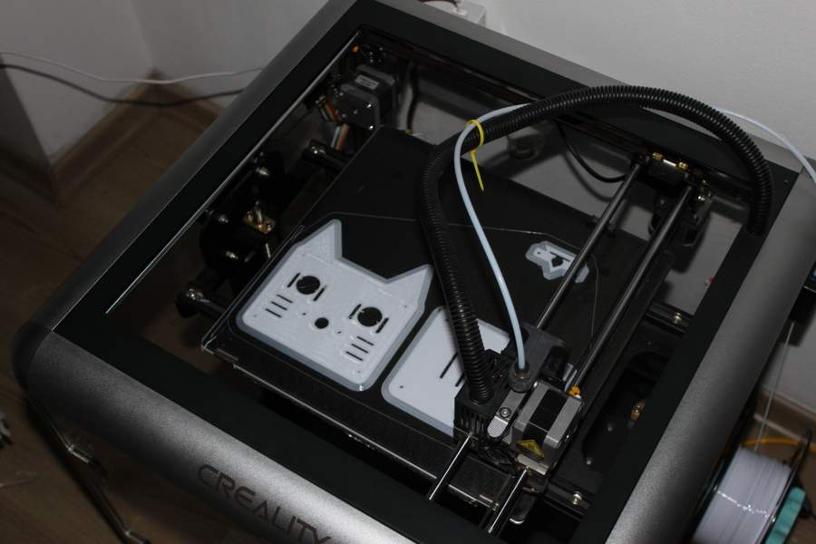

## IMG_9221 — Yazıcı ve baskı tablasının genel görünümü

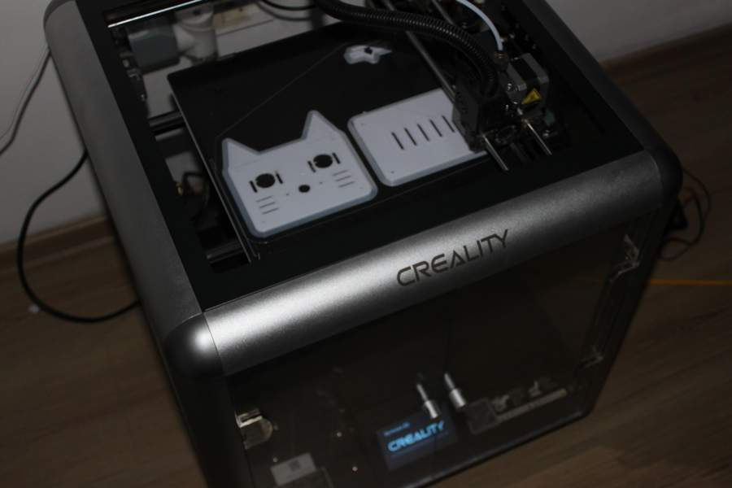

## IMG_9230 — USB bağlantılı geliştirme kartı — kesin model teyit bekliyor

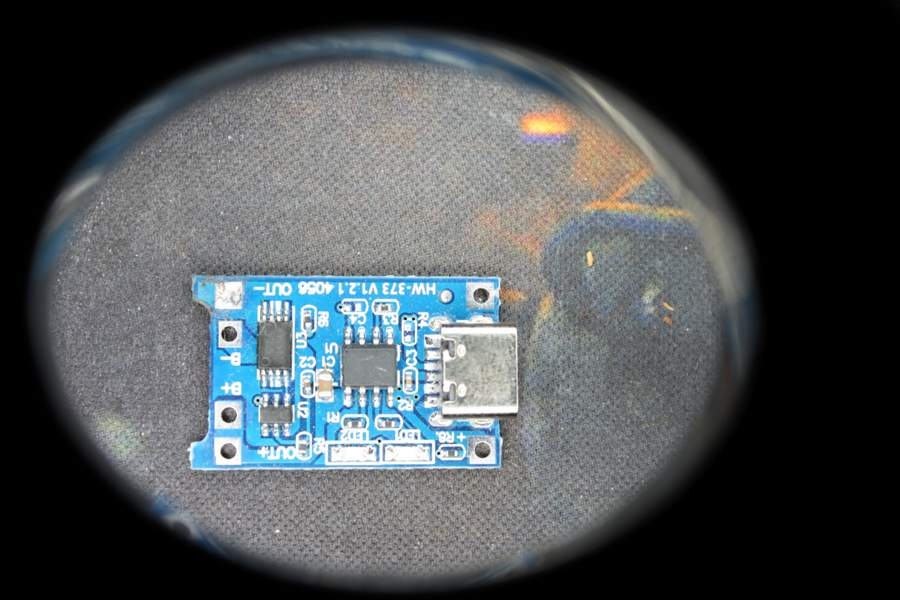

## IMG_9234 — ESP32-CAM ve kamera modülü

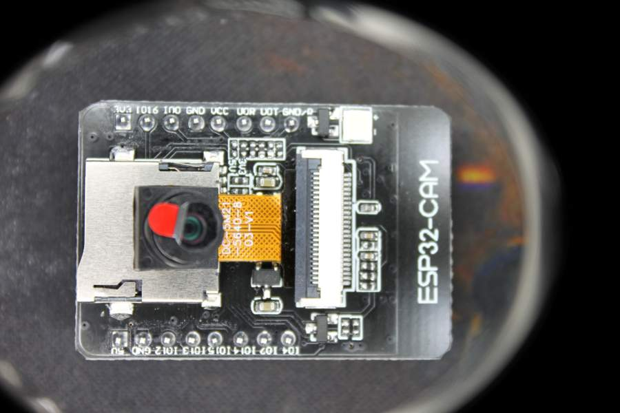

## IMG_9235 — GY-521 / MPU6050 kartı

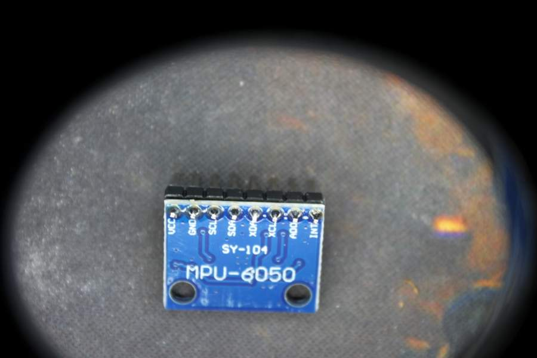

## IMG_9236 — Bluetooth seri modülünün arka yüzü

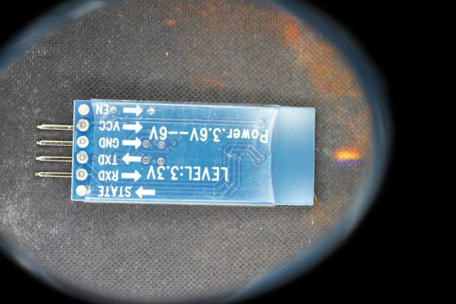

## IMG_9237 — Bluetooth seri modülünün ön yüzü — HC-06 siparişiyle eşleştirme adayı

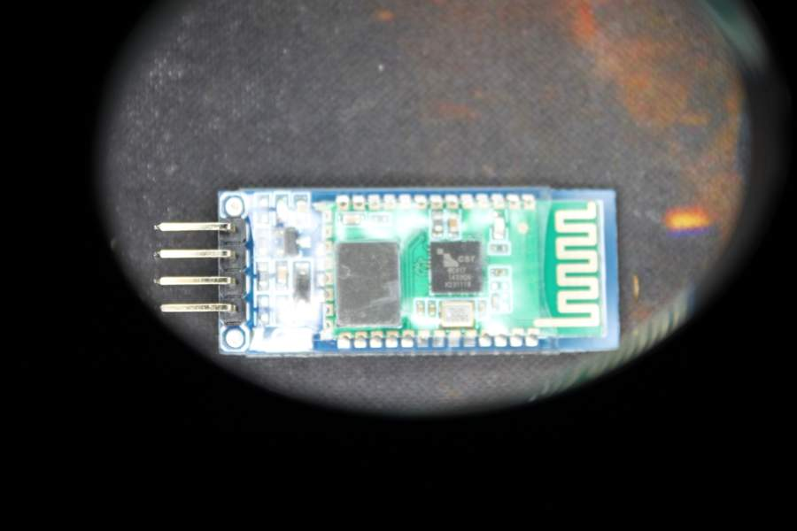

## IMG_9238 — Dairesel elektronik kart — model ve görev teyit bekliyor

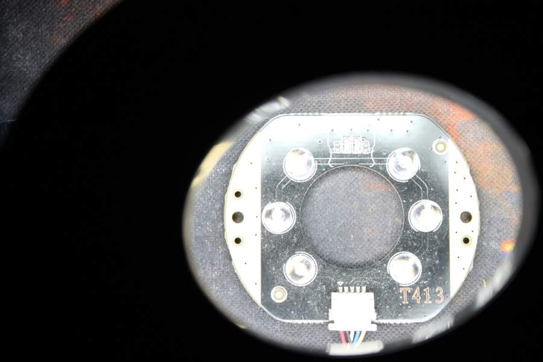

## IMG_9240 — 16×2 LCD ve I²C adaptörü

## IMG_9243 — SD kart modülü — ek deney donanımı

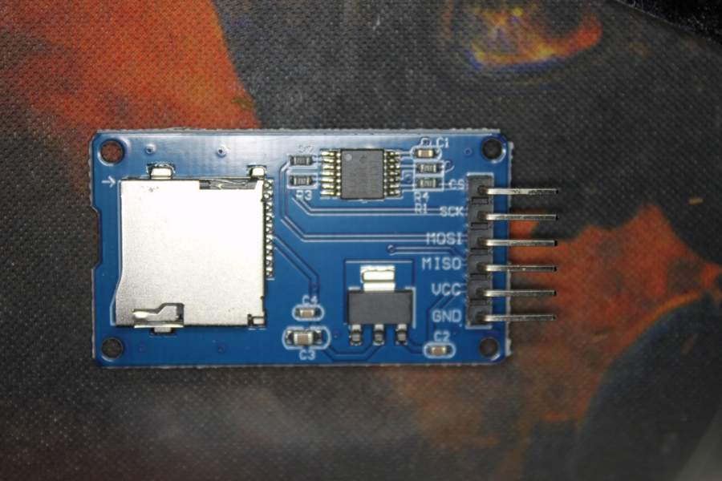

## IMG_9245 — İki hoparlör — güç/empedans ve kullanım teyit bekliyor

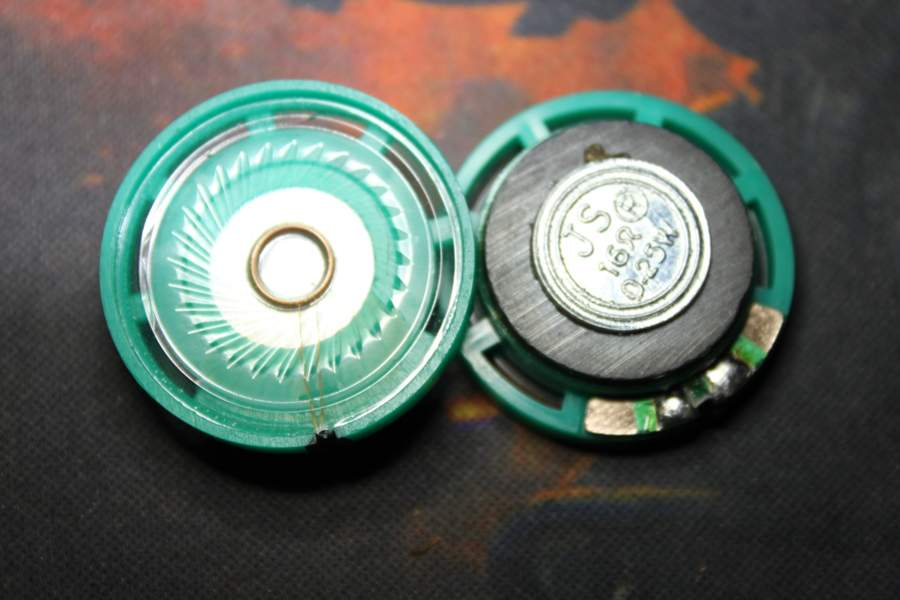

## IMG_9246 — Aç/kapa anahtarı — DC akım etiketi doğrulanacak

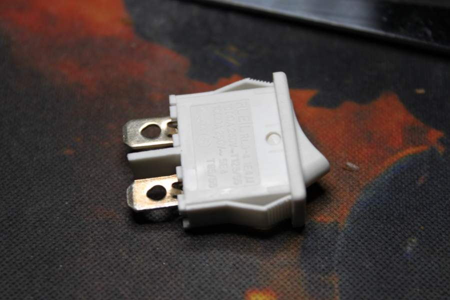

## IMG_9248 — Yuvarlak gövdeli motor — model ve elektriksel özellikler teyit bekliyor

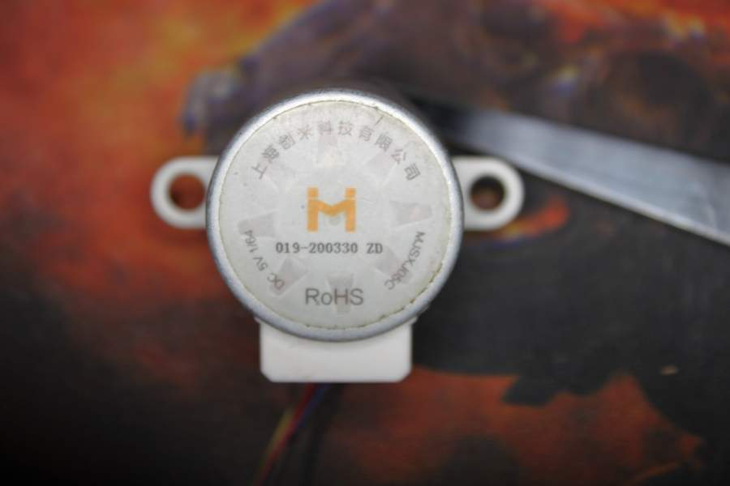

## IMG_9249 — MG996R servo ve çıkış mili

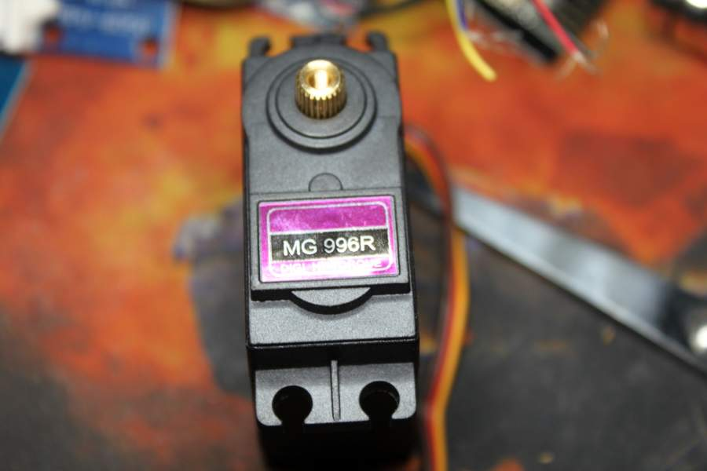

## IMG_9251 — DC motor — model/gerilim teyit bekliyor

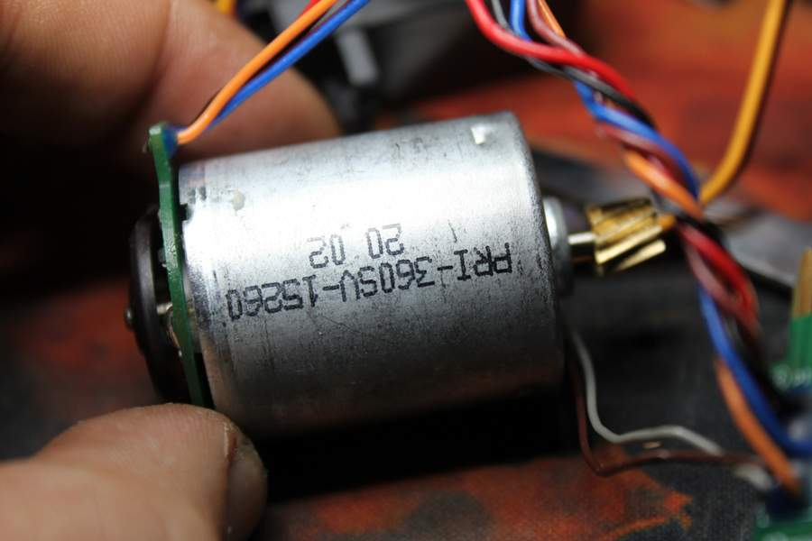

## IMG_9252 — Motor bağlantı kartı ve kablolar

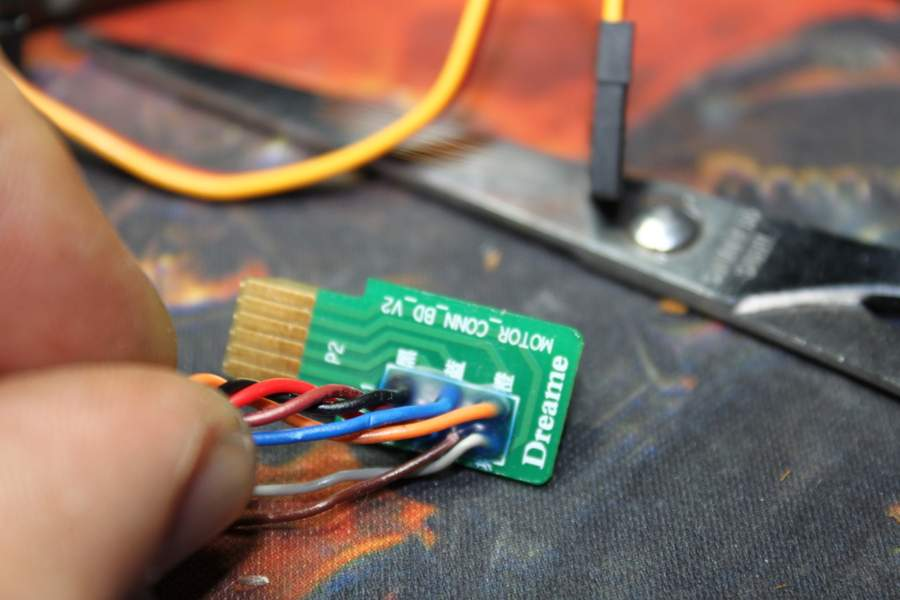

## IMG_9253 — Motor bağlantı kartının soket görünümü

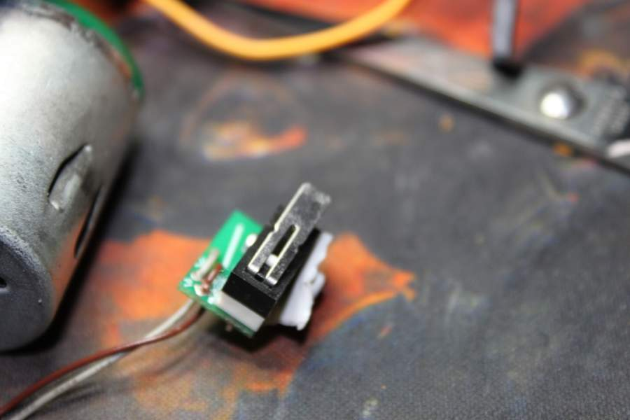

## IMG_9254 — Sökülmüş motor/dişli mekanizması, kart yüzü

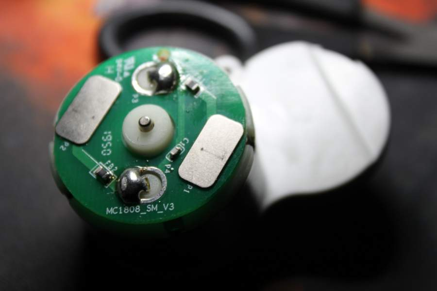

## IMG_9255 — Dişli mekanizmasının iç görünümü

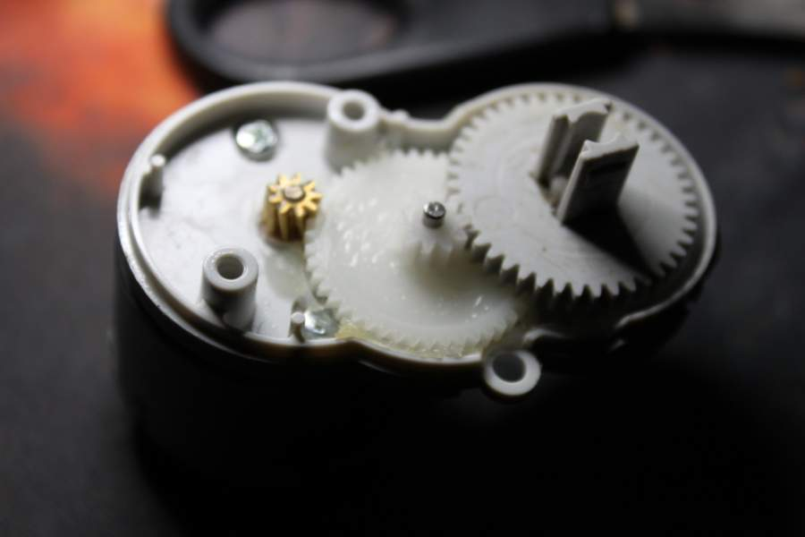

## IMG_9256 — Motor ve redüktör detayı

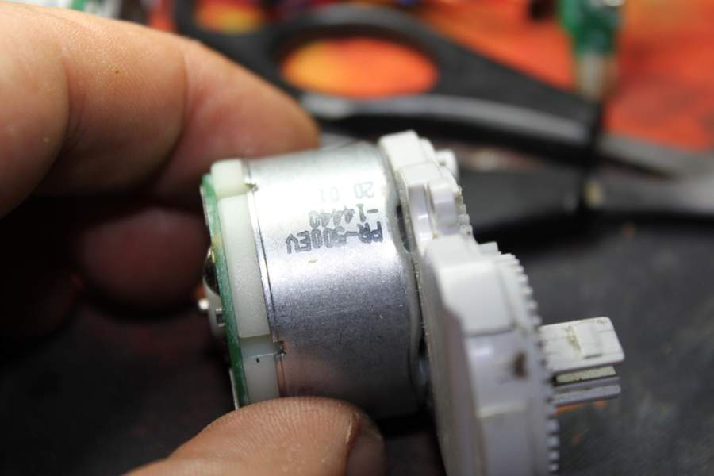

