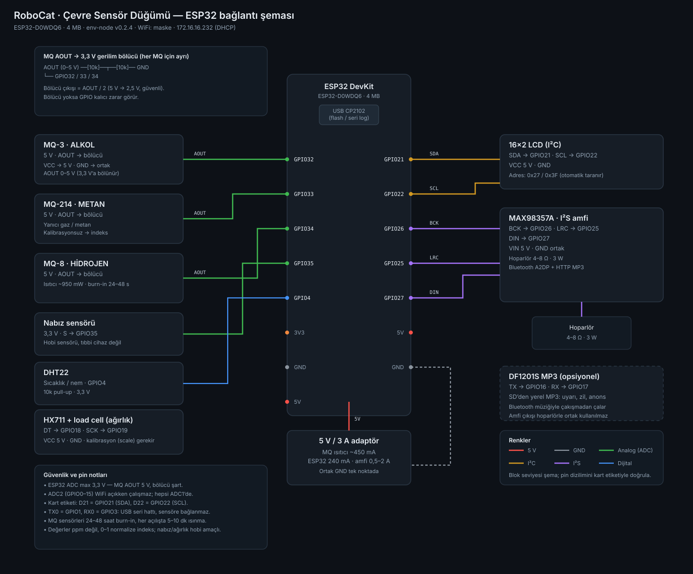

# Çevre sensör düğümü — ESP32 bağlantı şeması

*Blok seviyesi şema. Pin dizilimi kart üzerindeki etiketle doğrulanmalıdır.*

## Amaç

Hasta odası / atölye için kamerasız ortam izleme: alkol, metan, hidrojen, nabız, sıcaklık-nem ölçümü; 16×2 LCD'de özet, web arayüzünde canlı değerler. Müzik ve anons sesleri ayrı hat üzerinden.

## Kart

| | |
|---|---|
| Kart | **ESP32-D0WDQ6** (ESP8266 değil), 4 MB flash, CP2102 USB |
| MAC | `80:7d:3a:99:85:e8` |
| Firmware | `env-node` v0.1.0 |
| Ağ | `maske` WiFi → **172.16.16.222** (DHCP), mDNS `env-node.local` |
| Web | `http://172.16.16.222/` · `/api` |
| Durum | Kart bağlı ve yayında; I²C taraması henüz **boş** (LCD takılı değil) |

> Not: Bu kart ilk bakışta ESP8266 sanıldı; `esptool` ESP32-D0WDQ6 olduğunu doğruladı. A2DP + I²S + çok kanallı ADC yalnız ESP32'de var, bu yüzden proje bu kartla ilerliyor.

## Pin tablosu

| İşlev | Sensör / modül | ESP32 pini | Not |
|---|---|---|---|
| Alkol | MQ-3 AOUT | **GPIO32** (ADC1) | 5 V besleme + 10k/10k bölücü |
| Metan | MQ-214 AOUT | **GPIO33** (ADC1) | Bölücü |
| Hidrojen | MQ-8 AOUT | **GPIO34** (ADC1) | Bölücü, ısıtıcı ~950 mW |
| Nabız | Sensör S | **GPIO35** (ADC1) | 3,3 V, bölücü yok |
| Sıcaklık/nem | DHT22 DATA | **GPIO4** | 10k pull-up |
| LCD | SDA / SCL | **GPIO21 / GPIO22** | VCC 5 V, adres 0x27 veya 0x3F |
| Ses (I²S) | MAX98357A BCK / LRC / DIN | **GPIO26 / 25 / 27** | VIN 5 V, hoparlör 4–8 Ω |
| Yerel MP3 (ops.) | DF1201S TX / RX | **GPIO17 / 16** | SD'den uyarı/anons sesleri |

**ADC kuralı:** MQ sensörlerinin AOUT çıkışı 5 V'a kadar çıkabilir; ESP32 ADC'si **3,3 V** kabul eder. Her MQ hattına **10k/10k gerilim bölücü** konur (çıkış = AOUT/2). Ayrıca **ADC2 (GPIO0–15) WiFi açıkken kullanılamaz**, bu yüzden tüm analog girişler ADC1'dedir.

## Güç

| Yük | Akım |
|---|---|
| 3× MQ ısıtıcı | ~450 mA sürekli |
| ESP32 | 240 mA tepe |
| LCD + DHT | ~25 mA |
| MAX98357A + hoparlör | 0,5–2 A tepe |

**5 V / 3 A** adaptör, tek nokta ortak GND, MQ ısıtıcıları için ayrı 5 V dalı.

## Sensör gerçekleri

- MQ serisi **kalibrasyonsuz ppm iddia etmez**; panelde 0–1 normalize indeks gösterilir.
- MQ'lar **24–48 saat burn-in**, her açılışta **5–10 dk ısınma** ister.
- Nabız sensörü hobi amaçlıdır, tıbbi cihaz değildir.
- Metan/alkol ölçümü güvenlik sertifikası yerine geçmez; alarm senaryosu ayrıca tasarlanmalı.

## Ses mimarisi

| Mod | Yöntem | Durum |
|---|---|---|
| Müzik | Telefon/PC → **Bluetooth A2DP** → ESP32 → MAX98357A | Planlı (ESP32 Classic BT) |
| Yerel ses | DF1201S + SD kart (uyarı, zil, anons) | Opsiyonel |
| Otomatik akış | Sunucuda yt-dlp → HTTP MP3 → I²S | Sonraki aşama, kırılgan |

## Uçlar

| Uç | İçerik |
|---|---|
| `/` | Canlı kartlar (mV, raw, RSSI, heap) |
| `/api` | JSON: `adc[]`, `rssi`, `heap`, `uptime`, `i2c`, `lcd` |

## Sıradaki adımlar

1. LCD'yi bağla (SDA 21 / SCL 22) → I²C taraması adresi bulsun, ekran sayfaları açılsın.
2. MQ-3 / MQ-214 / MQ-8 + bölücüleri bağla → ham mV doğrula.
3. DHT22 ve nabız sensörünü ekle.
4. Kalibrasyon: boş oda baseline, sensör başına eğri.
5. Bluetooth A2DP hoparlör modu + panelden ses kontrolü.
6. İsteğe bağlı: `robocat.zk.net.tr`ye `role=other`, `capabilities=["env_sensor"]` ile event gönderimi.

## Kaynak

Yerel proje: `/root/env-node` (PlatformIO, `esp32dev`). Şema: `docs/images/env-node-wiring.svg`.
