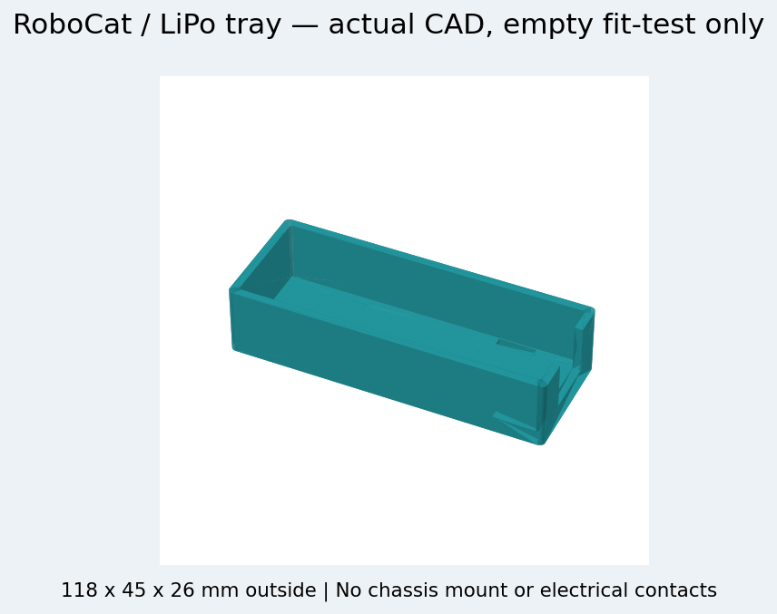

# RoboCat / görsel galeri

## Hedef görünüm — konsept

Beğenilen AI konsepti. Görseldeki kol, gövde bağlantıları ve renkli bacak kaplamalarının tamamı üretilebilir STL olarak hazırlanmış değildir. Montaj fotoğrafı veya ölçülendirme referansı değildir.

## Gerçek kafa geometrisi — v0.3

[STL / STEP](../custom/robocat-v0.3/stl) · [Kafa montajı STEP](../custom/robocat-v0.3/head_assembly.step) · [CAD kontrol kaydı](../custom/robocat-v0.3/assembly_check.json).

Kontrol yalnız kafa basılı parçaları ve temsili lensler için geçerlidir. Gövde, gerçek PCB/lens/ribbon kablo ve vidalar kapsam dışıdır. CAT10 kızak doğrulanmış bağlantı değildir ve baskı listesinde engellidir.

## LiPo tepsisi — boş uyum denemesi

[Tepsi kaynakları](../custom/print-fit-v0.4) · [Ölçü kontrolü](../custom/print-fit-v0.4/tray_validation.json).

Tek 108×35×21 mm katalog ölçülü LiPo için nominal 112×39×23 mm iç alan. Görsel yalnız gerçek CAD parçasıdır; gövde montajı, temas elemanları veya canlı pil içermez. Sıkıştırmasız, boş/dummy ölçü denemesi içindir; robot üzerinde kullanıma hazır değildir.

## Kontrol ve görüş

## Tek LiPo güç düzeni

Diyagramlar bağlantı mimarisini anlatır; kablo kesiti, pin numarası, komponent değeri veya şematik/ERC doğrulaması yerine geçmez.
