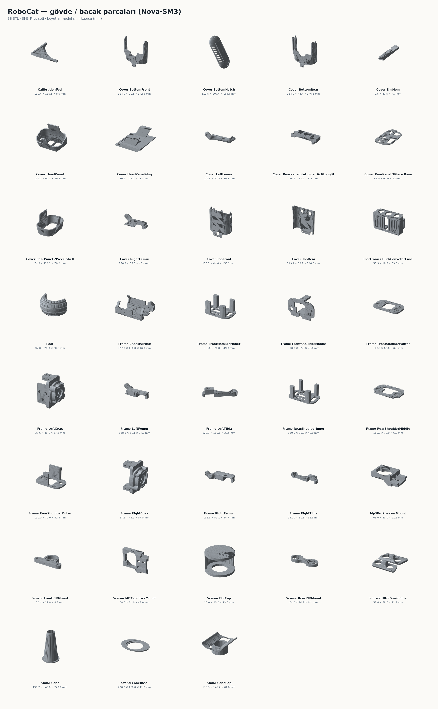
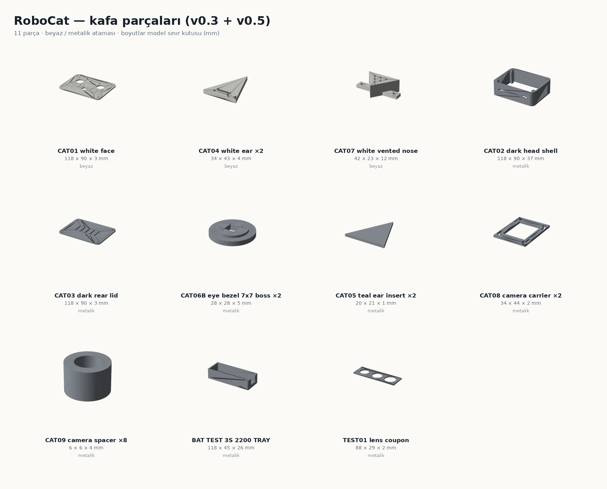
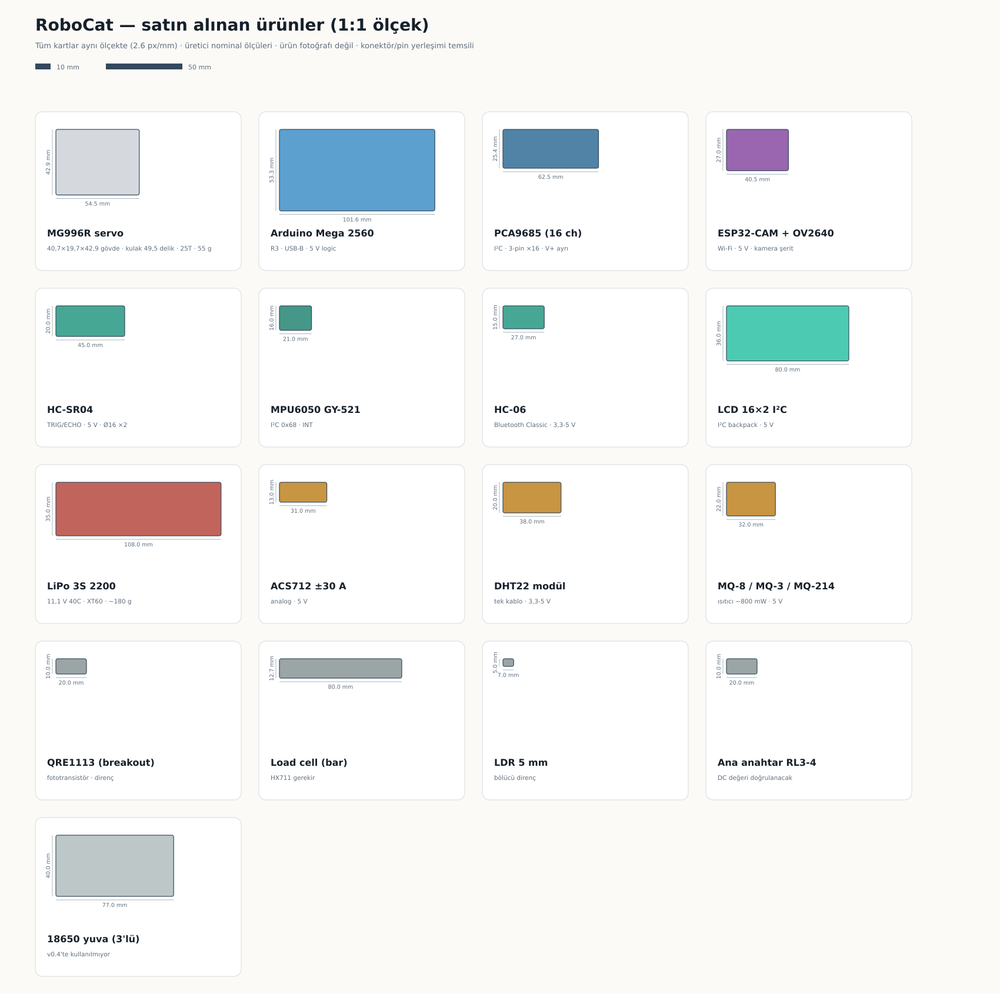

# RoboCat / görsel galeri

## Gerçek proje ve donanım fotoğrafları — 2026-10-26

[20 fotoğraflık albüm](BUILD_PHOTOS_2026-10-26.md): baskı aşaması, kartlar, sensörler ve motor mekanizmaları. Albümdeki `HW-373` kartı geliştirme kartı değil, 1S şarj/boost modülüdür; dairesel kart ve BLDC motorlar robot süpürgeden sökülmüş, RoboCat envanteri dışındadır. Fotoğraflarda Arduino Mega yoktur. Fotoğraf çalışma testi veya tam teslim teyidi değildir.

## Hedef görünüm — konsept

Beğenilen AI konsepti. Görseldeki kol, gövde bağlantıları ve renkli bacak kaplamalarının tamamı üretilebilir STL olarak hazırlanmış değildir. Montaj fotoğrafı veya ölçülendirme referansı değildir.

## Gerçek kafa geometrisi — v0.3

[STL / STEP](../custom/robocat-v0.3/stl) · [Kafa montajı STEP](../custom/robocat-v0.3/head_assembly.step) · [CAD kontrol kaydı](../custom/robocat-v0.3/assembly_check.json).

Kontrol yalnız kafa basılı parçaları ve temsili lensler için geçerlidir. Gövde, gerçek PCB/lens/ribbon kablo ve vidalar kapsam dışıdır. CAT10 kızak doğrulanmış bağlantı değildir ve baskı listesinde engellidir.

## LiPo tepsisi — boş uyum denemesi

[Tepsi kaynakları](../custom/print-fit-v0.4) · [Ölçü kontrolü](../custom/print-fit-v0.4/tray_validation.json).

Tek 108×35×21 mm katalog ölçülü LiPo için nominal 112×39×23 mm iç alan. Görsel yalnız gerçek CAD parçasıdır; gövde montajı, temas elemanları veya canlı pil içermez. Sıkıştırmasız, boş/dummy ölçü denemesi içindir; robot üzerinde kullanıma hazır değildir.

## Kontrol ve görüş

## Tek LiPo güç düzeni

Diyagramlar bağlantı mimarisini anlatır; kablo kesiti, pin numarası, komponent değeri veya şematik/ERC doğrulaması yerine geçmez.

## PETG renk dagilimi — iki makara

Iki renk PETG (beyaz + metalik) ile v0.4 uyum islerinin renk atamasi. Gorsel CAD geometrisinden uretilmistir; baski, montaj veya renk dogrulugu kaniti degildir. Guncel baskı listesi: [v0.4](../custom/print-fit-v0.4/README.md).

| Renk | Parcalar | Adet |
|---|---|---:|
| Beyaz | CAT01 yuz, CAT04 kulak x2, CAT07 burun | 4 |
| Metalik | CAT02 kasa, CAT03 arka kapak, CAT06 goz halkasi x2, CAT08 kamera tasiyici x2, CAT09 mesafe pulu x8, CAT05 kulak ici x2, BAT_TEST tepsi, TEST01 kupon | 18 |

CAT10 kizak, BAT01 kartus kapagi ve eski 18650 parcalari bu dagilimda yoktur; v0.4 kontratinda engellidir. CAT05 kulak ici iki renkten birine atanmistir; konseptteki turkuaz rengin karsiligi yoktur.

## Düzeltilmiş CAT06B / metalik ilk deneme

Üç kabuklu eski dosya yerine tek birleşik katı. Büyük ön yüz tabanda, merkezleme bileziği yukarı yönlendirilmiştir. Önce bir adet metalik PETG denemesi; gerçek kamera görüntüsü ve kuru uyum kontrolü yapılmadan yapıştırma yok. [Metalik aşama ve profil adayı](../custom/petg-stage-v0.5/README.md). Yukarıdaki renk dağılımı görseli eski yuvarlak CAT06'yı gösterir; CAT06B kare varyantının son geometrisi bu görseldedir.

## Uygulama akışı ve montaj sırası

Şemalar süreç sırasını anlatır; ölçüm ve testlerin yerine geçmez. Ölçü değerleri kesit tabanlıdır, baskı toleransı ayrıca doğrulanır.

## Bağlantı şablonu

## Parça kataloğu — baskı parçaları

### Gövde / bacak (Nova-SM3, 38 STL)

`Nova-SM3/STL Files/SM3 Files` setinin tamamı. Boyutlar model sınır kutusudur (mm); baskı yönü ve destek kararı ayrıca verilir.

### Kafa (v0.3 + v0.5, 11 parça)

Beyaz/metalik ataması renkli gösterilmiştir. CAT06B v0.5'te tek geçerli katı olarak yeniden üretilmiştir (7×7 kare geçiş).

## Satın alınan ürünler — 1:1 ölçekli

Tüm kartlar aynı ölçektedir. Ölçüler üretici nominal değerleridir; ürün fotoğrafı değildir ve konektör/pin yerleşimi temsili gösterilmiştir.

