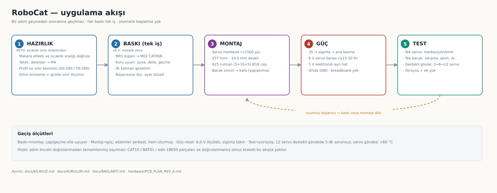
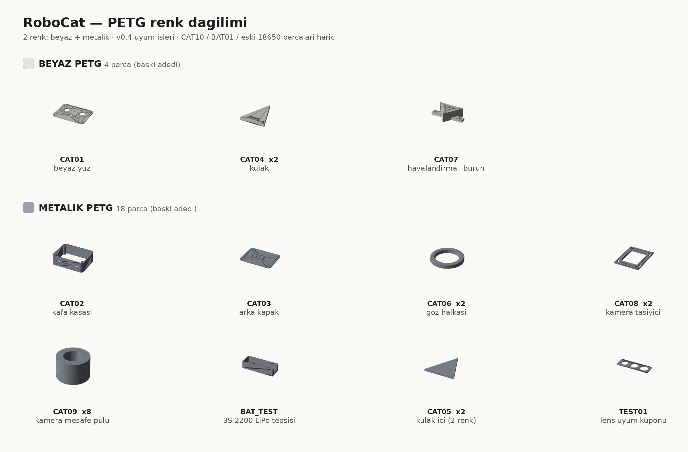

# RoboCat — uygulama kılavuzu

Bu belge **bugünkü durumdan ilk yürüyüş testine** kadar sırayı anlatır. Ölçülmüş veri, varsayım ve henüz doğrulanmamış olan ayrı işaretlenmiştir. Tam çalışan robot, bitmiş kol veya üretime hazır PCB iddiası yoktur.

## Akış



*Beş aşama ve geçiş ölçütleri. Başarısız uyum/ısı testinde bir önceki aşamaya dönülür; adımlar atlanmaz.*

## 0) Bugün neredeyiz

| Alan | Durum |
|---|---|
| Mekanik | Nova-SM3 tabanlı gövde/bacak; kafa parçaları v0.3, uyum işleri v0.4 |
| Elektronik | Mega 2560 + PCA9685 + 16 MG996R envanterde; 2× XL4016 siparişte; 5 V elektronik/6 V tek-bacak adayı, yük testi yok |
| Batarya | Tek 3S 2200 mAh LiPo hedefi; hot-swap iptal |
| Yazılım | Nova firmware (Mega v4.x) referans; RoboCat için doğrulanmış yürüyüş yok |
| Görüş | 3× ESP32-CAM planı; tanıma/takip uygulanmadı |

**Ana sipariş/teslim/test takibi:** [KURULUM.md](KURULUM.md#sipariş-ve-kabul-takibi--2026-10-26). Yeni siparişler teslim edilmiş sayılmaz.

## 1) Parçalar

- [Envanter](../hardware/INVENTORY.md): 16 MG996R (12 bacak + 4 kol adayı), Mega, PCA9685, 2 IMU, 5 ultrasonik, 3 ESP32-CAM, HC-06, LCD.
- **Teslim alındı, test bekliyor:** 2× XL4016 (5 V/6 V yük ve ısınma testi), **625 rulman (5×16×5)** (cep/geçme testi), 2× TCA9548A (kanal testi), **6 V servo regülatörü** (kapasite/termal testi), XT60 + 18–20 AWG kablo, 12× 3-pin servo uzatma.
- **Hâlâ eksik / seçilmedi:** 3S LiPo, DC sigorta + ana kesme, LiPo düşük hücre koruması, balanslı şarj cihazı, 25T servo horn, M3/M4 vida-somun, HX711 (load cell için).
- **Basılmayacak parçalar:** CAT10 kızak, BAT01 kartuş kapağı, eski 18650 kaset gövdesi/kapağı/kızağı, doğrulanmamış omuz ultrasonik braketi.

## 2) Baskı kılavuzu

Yetkili liste: [v0.4 talimatı](../custom/print-fit-v0.4/README.md) + [manifest](../custom/print-fit-v0.4/print_manifest.json). Parça görselleri: [katalog](GALLERY.md#parça-kataloğu--baskı-parçaları). Bütün klasörü otomatik basmayın; her iş ayrı ve elle başlatılır.

| Sıra | İş | Adet | Not |
|---:|---|---:|---|
| 1 | TEST01 lens kuponu | 1 | Ölçü denemesi |
| 2 | CAT08 kamera taşıyıcı | 1 | Kart/lens/ribbon |
| 3 | CAT04 kulak | 1 | Tolerans |
| 4 | CAT05 kulak içi | 1 | Tolerans |
| 5 | CAT01 yüz | 1 | Zaten basıldıysa tekrar basma |
| 6 | CAT02 kasa | 1 | İki yan köprüyü incele |
| 7 | CAT03 arka kapak | 1 | Kuru montaj |
| 8 | BAT_TEST LiPo tepsisi | 1 | Boş/dummy; canlı pil yok |

### İki renk PETG dağılımı



*v0.5 sırası: önce metalik (M01–M06), beyaz aşama sonra. CAT06B artık 7×7 kare çerçeve.*

| Renk | Parçalar |
|---|---|
| Beyaz | CAT01 yüz, CAT04 kulak ×2, CAT07 burun |
| Metalik | CAT02 kasa, CAT03 kapak, CAT06 göz halkası ×2, CAT08 taşıyıcı ×2, CAT09 mesafe pulu ×8, CAT05 kulak içi ×2, BAT_TEST tepsi, TEST01 kupon |

### Dilimleme / yazıcı ayarları (bu oturumda kullanılan)

| Ayar | ASA (kullanıldı) | PETG (planlanan, **uygulanmadı**) |
|---|---|---|
| Nozzle / yatak | 250 / 90 °C | 240 / 80 °C |
| Katman | 0,20 mm (ilk 0,20) | doğrulanacak |
| Duvar / dolgu | 4 duvar / %20–35 | doğrulanacak |
| İlk katman hızı | 28 mm/s | doğrulanacak |
| Brim / skirt | 6 mm / **skirt kapalı** | aynı |
| Z-hop | **0,3 mm** | aynı |

Kurallar (denenmiş):
- Yatak temizliği: ılık su + bir damla bulaşık deterjanı → durula → mikrofiber → %99 IPA. Yüzeye parmak değmesin.
- **Skirt açıkken** parçalar yatak sınırını aşabilir → dilimledikten sonra **gcode gövde sınırlarını ölç** (X 0–280, Y 0–260).
- Art arda iki işi **aynı koordinata** başlatmayın; parça yataktayken nozul çarpar.
- Baskı sırasında `M104` ile sıcaklık testi yapmayın (soğuk ekstrüzyon).
- Filaman biterse yazıcı pause eder; yeni makara + purge + `RESUME`.

## 3) Ölçülen uyum verileri (güncel set)

Set: `Nova-SM3/STL Files/SM3 Files` (`SM3_Frame_*`, `SM3_Foot`). Eski `SM2*` / `SMLUpperArm` parçaları karıştırılmamalı.

| Ölçüm | Değer | Durum |
|---|---|---|
| Servo gövde yuvası (Coax / Femur) | 20,0 × 20,0 / 20,1 × 20,0 mm | Ölçüldü |
| MG996R gövde genişliği | 19,7 mm (üretici verisi) | Genişlik uyuyor (0,3–0,4 mm boşluk) |
| Rulman yuvası | Ø≈16 mm, yatak derinliği **≈3,6–4,0 mm** | Ölçüldü (adet doğrulanmadı) |
| Rulman iç çapı | **Ø5,0–5,5 mm** delikler | Ölçüldü → **625 (5×16×5) uyumlu** |
| Horn vida deseni | M3 çiftleri **10,0 mm** (baskın), 13,9 mm | Ölçüldü |
| Yüz göz deliği | Ø20 mm, merkezler ±30 mm | Ölçüldü |
| CAT06 göz halkası | Ø28 dış / Ø20 iç × 3 mm | Ölçüldü |

**Doğrulanmadı:** MG996R'nin yuva **boy/derinlik** uyumu, horn kalınlığı/merkez vidası, gerçek baskı toleransı. Bunun için 20,0 mm yuva + 10,0 mm delik çifti + Ø16 rulman yuvası içeren **uyum kuponu** basılmalı.

### Servo açıları
Firmware `NovaServos.h` (v4.1) `servoHome` / `servoLimit` **PCA9685 tick** değerleridir (60 Hz → 4,07 µs/tick). Örnek: knee 365–607 tick ≈ 1485–2470 µs. DS3218 (270°) ile MG996R (180°) aynı tick'te **farklı açı** verir → **DS kalibrasyonu MG996R'ye kopyalanmaz**; merkezler ve limitler yeniden çıkarılır.

## 4) Montaj kuralları

- **Vidalı:** servo hornları, rulmanlı pivotlar, M3/M4 bağlantı noktaları.
- **Yapıştırma:** yüz/kapak/burun/göz çerçevesi gibi sökülmeyen kapaklar. Nötr kürlenen silikon (sökülebilir) veya CA; ince film, IPA temiz yüzey, 24 saat kür.
- Göz çerçevesi alternatifi: `custom/robocat-v0.3/stl/CAT06B_eye_bezel_7x7_boss_x2.stl` (7×7 kare delik, Ø19,6 merkezleme bileziği, vidasız).

## 5) Güç

Şema: [güç yolu](images/robocat-power.svg) · ayrıntı: [PCB/test planı](../hardware/PCB_PLAN_REV_A.md).

```
3S LiPo (11,1 V) → XT60 → sigorta → ana kesme
        ├── 6 V yüksek akım regülatör → servo barası (PCA9685 V+)
        └── 5 V regülatör → Mega / kamera / sensörler
```

- LiPo **doğrudan servolara bağlanmaz**; servo gücü breadboard/Dupont'tan geçmez.
- Ortak GND, kalın kablo, ayrı servo barası.
- USB ile harici besleme aynı anda ters besleme yapmayacak.
- Sigorta ve düşük hücre gerilimi koruması seçilmedi. 2× XL4016 siparişte; görevleri ve kabul koşulları [ana kurulum takibinde](KURULUM.md#sipariş-ve-kabul-takibi--2026-10-26).

## 6) Test sırası

1. **Tek servo:** ayarlı kaynak 6,0 V / ~3 A limit, PCA9685 ch0; horn/yük olmadan yaklaşık merkezden küçük adımlarla başla. Mekanik sona veya stall'a zorlamadan merkez, yön, güvenli sınır ve boşta/hareket akımını kaydet.
2. **Yuva denemesi:** gövde, horn, rulman, vida boyu; sıkışma var mı.
3. **Tek bacak (3 servo):** tek tek sonra birlikte; sıkışma, sıçrama, 5 dk tutma sonrası gövde sıcaklığı (**<60 °C** hedef), besleme düşümü.
4. **Destekli gövde (12 servo):** 6 V / ≥15–20 A kaynak, kademeli 3 → 6 → 12; toplam akım, rail gerilimi, ısınma. **3 A limitli kaynakla 12 servo ölçülmez** (akım limiti ile servo yükü karışır).
5. Yürüyüş, sonra ek yük (kol, kafa) ve kamera/sensör gürültü testi.
6. Ölçülen akıma göre regülatör/sigorta/konnektör/PCB seçimi.

## 7) Sorun giderme (bu oturumdan)

| Belirti | Neden | Çözüm |
|---|---|---|
| İlk katman yapışmıyor | Yağlı yatak / hızlı ilk katman | Deterjan + IPA; 28 mm/s; brim 6 mm |
| Katman kayması | Z-hop 0, kalkan kenara nozul sürtmesi | Z-hop 0,3 mm; travel 300 mm/s |
| `Move out of range` | Skirt + brim yatak dışına taşıyor | Skirt kapalı; gcode sınırlarını ölç |
| İptal komutu takılıyor | Klipper RPC "pending" | Klipper servisini yeniden başlat |
| Dosya "currently in use" | Baskı sürerken silme | Önce durdur/restart, sonra sil+yükle |

## 8) Bağlantılar

[Görsel galeri](GALLERY.md) · [Sistem](SYSTEM.md) · [Baskı merkezi](PRINTING.md) · [Yol haritası](ROADMAP.md) · [Kaynak haritası](SOURCES.md) · [Donanım](../hardware/README.md)
