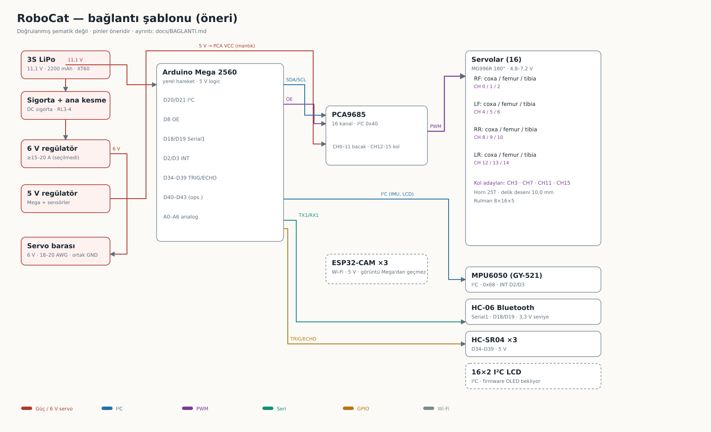
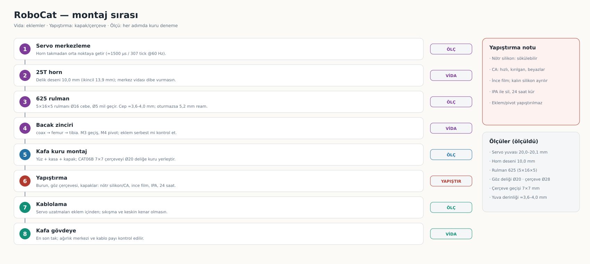

# RoboCat — kurulum

Kurulumu üç aşamaya ayırıyorum: **yazılım**, **elektronik**, **mekanik**. Aşağıdaki maddelerin bir kısmı **kod değişikliği** veya **satın alma** gerektirir; tamamlanmış kurulum yoktur.

## A) Yazılım kurulumu

1. **Arduino IDE 2.x** kur.
2. Kütüphaneler: depodaki `Nova-SM3/Code/Arduino Libraries/` klasörünü kullan.
   - Klasör halinde olanları `~/Arduino/libraries/` içine kopyala (Adafruit_GFX, Adafruit_NeoPixel, Adafruit-PWM-Servo-Driver-Library, Adafruit_SSD1331, EEPROM, NewPing, PS2X_lib, SPI, T4_PowerButton, Wire).
   - `.zip` olanı (DFRobot_DF1201S) IDE → Sketch → Include Library → Add .ZIP Library ile ekle.
3. Sketch: `Nova-SM3/Code/Nova-SM3_mega-v4.2/Nova-SM3_mega-v4.2.ino` (+ `AsyncServo.h`, `NovaServos.h` aynı klasörde kalmalı).
4. Kart: **Arduino Mega or Mega 2560**, işlemci **ATmega2560**, doğru port. Yüklemeden sonra Seri Monitör 115200.

### Firmware ile donanım farkları (kurulumu bloke eder)

| Konu | Firmware ne bekliyor | Bizde ne var | Gereken |
|---|---|---|---|
| I²C çoklayıcı | **TCA9548A** (`tca_select(tca_pwm)` / `tca_mpu`) | Envanterde yok | TCA9548A al **veya** kodu tek PCA9685 (0x40) için düzenle |
| Kumanda | **PS2 alıcı** (`PS2X`) | **HC-06** Bluetooth | HC-06 için Serial1 komut protokolü yazılmalı |
| PWM kanalı | 2 sürücü kimliği (1/2) | 1× PCA9685 | 16 servo = tek kartın **tamamı**; ek kanal yok |

Bu iki kod değişikliği yapılmadan firmware olduğu gibi çalışmaz.

## B) Elektronik kurulum (öneri — fiziksel doğrulama bekliyor)



*Renkler: güç, I²C, PWM, seri, GPIO. Şema blok seviyesindedir; kablo kesiti ve modül pinleri ayrıca doğrulanır.*

Pin önerisi: [PINMAP_REV_A.csv](../hardware/PINMAP_REV_A.csv). Bu tablo **öneridir**, gerçek modül/pin kontrolü yapılmadı.

```
3S LiPo → XT60 → sigorta → ana kesme
   ├── 6 V regülatör ──► servo barası (PCA9685 V+)
   └── 5 V regülatör ──► Mega / HC-06 / sensörler
```

| Bağlantı | Not |
|---|---|
| PCA9685 SDA/SCL → Mega D20/D21 | I²C; modül 3,3/5 V seviyesi doğrulanacak |
| PCA9685 OE → D8 | Açılışta devre dışı (pull-up) |
| PCA9685 V+ | **6 V servo barası** (LiPo değil), GND ortak |
| HC-06 TX → D19 / RX → D18 | Mega Serial1; seviye dönüşümü kontrol edilecek |
| MPU6050 | I²C (TCA yoksa 0x68) |
| HC-SR04 ×3–5 | D34–D43 (5 V) |
| Servo kanalları | 0–11 bacak, 12–15 kol (koddaki sıra farklı olabilir) |

Kurallar: servo gücü breadboard/Dupont'tan geçmez; ortak GND tek noktada; USB ile harici besleme aynı anda ters besleme yapmayacak.

## C) Mekanik montaj sırası



*Sekiz adım, her adımda kuru deneme. Ölçüler kesitle doğrulanmış değerlerdir; baskı toleransı ayrıca denenir.*

1. **Servo merkezleme:** horn takmadan önce her servoyu orta noktaya getir (≈1500 µs / 307 tick @60 Hz).
2. **Horn:** 25T alüminyum hornu servo dişlisine oturt, merkez vidasını sık (vida boyu dibe vurmasın). Horn-parça delik deseni **10,0 mm** (ikincil 13,9 mm) — takmadan önce kuru dene.
3. **Rulman (625 · 5×16×5):** Ø16 cebe oturt, Ø5 mil geçir. Cep derinliği ölçümü ≈3,6–4,0 mm; rulman 1 mm dışarıda kalırsa cebi 5,2 mm'ye ream et.
4. **Bacak zinciri:** coax → femur → tibia; M3 geçiş, M4 pivot. Sıkma sırasında eklem serbest mi kontrol et.
5. **Kafa:** yüz + kasa + arka kapak; burun ve göz çerçevesi **yapıştırma** (nötr silikon/CA, ince film, IPA temiz yüzey, 24 saat).
6. **Kablolama:** servo uzatmaları eklem içinden geçir, hareket açıklığında sıkışma olmasın.
7. **Son montaj:** kafa gövdeye en son; ağırlık merkezi ve yürüyüş dengesi testte kontrol edilir.

Göz çerçevesi alternatifi: `custom/robocat-v0.3/stl/CAT06B_eye_bezel_7x7_boss_x2.stl` (vidasız, Ø19,6 merkezleme bileziği).

## D) İlk açılış kontrol listesi

- [ ] Servo barası **6,0 V** ölçüldü, GND ortak, sigorta takılı
- [ ] I²C tarama: PCA9685 (0x40), MPU6050 (0x68) görünüyor
- [ ] Tek servo: merkez, yön, güvenli min/maks (bkz. [Kılavuz](KILAVUZ.md) §6)
- [ ] Tek bacak: sıkışma yok, 5 dk tutmada servo gövdesi <60 °C
- [ ] Kalibrasyon: `servoHome` / `servoLimit` MG996R için **yeniden** çıkarıldı
- [ ] Destekli gövde: 3 → 6 → 12 servo kademeli, akım/gerilim kaydı
- [ ] HC-06 bağlantısı ve acil durdurma davranışı test edildi

## E) Kurulumu bloke eden eksikler

6 V regülatör (≥15–20 A sınıfı, seçilmedi) · ayrı 5 V regülatör · DC sigorta + ana kesme · LiPo düşük gerilim koruması · balanslı şarj · 25T horn · **625 rulman (5×16×5)** · M3/M4 vida-somun · **TCA9548A veya kod düzenlemesi** · **PS2 → HC-06 kod düzenlemesi**

Bunlar tamamlanmadan "kurulum bitti" denemez; yalnız tek servo / tek bacak masaüstü testleri yapılabilir.
